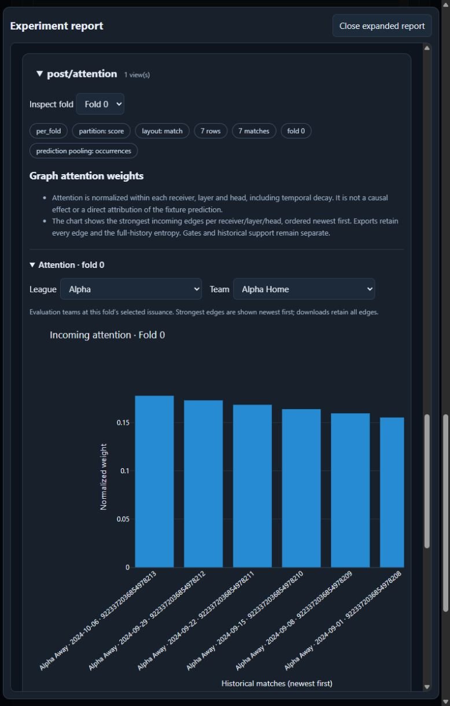
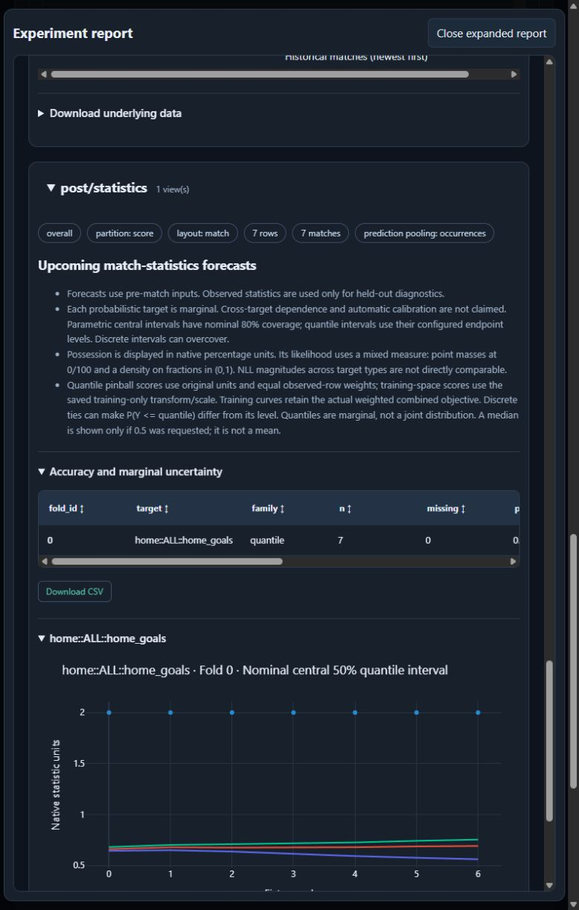

# Native browser verification, 2026-10-16

Verified the native localhost builder on integration base a5e4ad42f231ddab574ed96bde8822bb25d74a80 with an isolated synthetic workspace. No production fit, frozen artifact, main checkout or research checkout was changed.

## Finding and repair

Creating a numeric statistic target initialized hidden required lower/upper bounds; changing bounded support back to count also retained them. Native validation correctly rejected these inappropriate bounds. Both the inventory decorator and curated inventory now mark these fields clear_when_hidden. A renderer regression covers default creation, typed identity fields, bounded edits and switching back to count. No neural runtime or model mathematics changed.

## Verified interactions

- Edited numeric target identity/source/units, support and scaling with native keyboard events. Initial automation fill did not commit change events; this was an automation issue, not a product defect.
- Prepared 23 synthetic rows: 16 training and 7 scoring. Enabled checkpointing and prediction_only finalization, with input residency still disabled.
- Saved the JSON recipe and downloaded Python export. Parsed its recipe literal without executing it; identity, source, robust scaling and finalization persist.
- Completed two separate two-update CPU fits with fixed-day memory (7 days and 365 days). The short interval exercises empty explicit-edge history; the long interval supplies populated attention.
- Inspected loss plots, PCA embedding find/reset and league visibility controls, attention league/team selectors, newest-first match order, and numeric statistics tables/forecast curves.
- Browser console inspection returned no warning/error entries.

Run IDs: e14cd282-8c1a-47ac-b061-6f02d5491a8a and 4bad29ad-e3f2-495a-bd26-824ee833c311. Synthetic league/team names are intentional; no predictive-performance claim is made.

## Regression results

48 Python tests passed (14.04 seconds), and 32 renderer tests passed. Receipts and source hashes are in browser-verification.json.

```powershell
$env:PYTHONPATH=(Join-Path (Get-Location) 'src')
$env:PYTHONDONTWRITEBYTECODE='1'
$env:CUDA_VISIBLE_DEVICES='-1'
& 'C:/Users/luisi/Documents/Programming/Python/.misc314/Scripts/python.exe' -m pytest tests/analytics/test_ui_inventory.py tests/analytics/test_ui_catalog_compatibility.py tests/analytics/test_graph_numeric_targets.py -q --tb=short --junitxml=docs/analytics/gat_feature_integration/browser-fix-tests.xml
node --experimental-vm-modules --test tests/analytics/ui_cnn.mjs tests/analytics/ui_composition.mjs tests/analytics/ui_feature_bundles.mjs tests/analytics/ui_feature_discovery.mjs tests/analytics/ui_svm.mjs
```

## Limits

The CSV link contains a populated data URL, but clicking it did not produce a download event or saved file in the in-app browser. CSV download is therefore unverified. This bounded check used one fold and PCA; it does not establish multi-fold interaction, tSNE, real badge coverage, SVG export or hosted CI. Earlier exact CUDA parity/continuation evidence remains scoped to its recorded runtime; this UI-only fix does not warrant another GPU run. The branch remains unmerged and unpushed.



