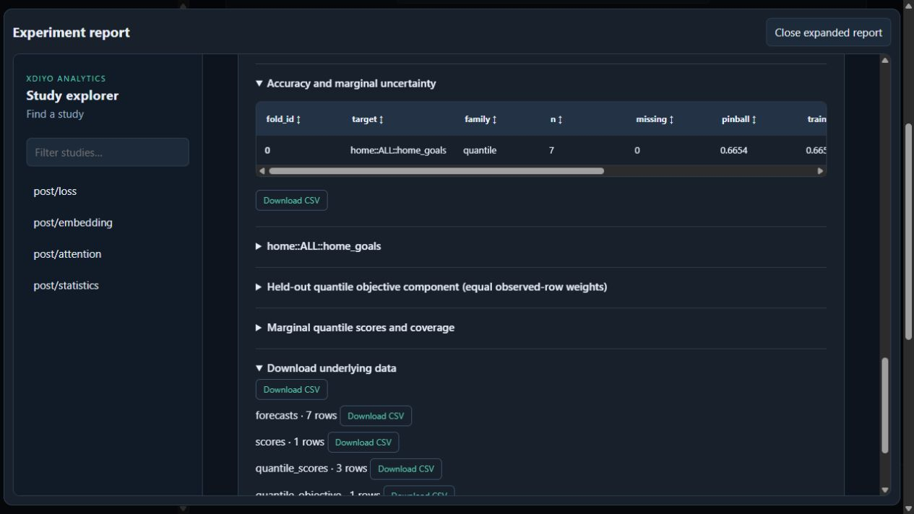

# CSV browser follow-up, 2026-10-16

## Result

Native **Download CSV** clicks now produce completed downloads in the Codex in-app browser, both inline and in the expanded report. Downloaded summary files (218 bytes, one row) and the complete seven-row forecasts file (1,385 bytes) match the report's original CSV payloads byte for byte. Parsed columns, row counts, UTF-8 BOM, zero values and numerical precision are preserved. See `csv-verification.json` for file hashes and receipt details.

## Diagnosis and repair

The original data-URL links did not complete in the managed in-app browser or Chrome. Chrome diagnostic events reported the bytes received but no completed download. A controlled standalone comparison in the in-app browser succeeded with a Blob and failed with the unchanged data URL. Blob downloads from the opaque-origin sandboxed frame still stalled.

The viewer now materializes a CSV Blob only on click for standalone reports. In the native builder, a parent handshake enables download forwarding. The builder accepts only a currently mounted report frame with an opaque origin and an exact CSV URL/filename pair already contained in that frame's supplied report HTML. Requests from other windows, detached frames, arbitrary URLs, changed payloads and substituted names are rejected. The allowlist is built lazily and weakly owned by the frame; decoded data is not retained. Blob URLs are released after triggering the download. The iframe keeps `allow-scripts allow-downloads`; same-origin access was not added.

Existing encoded CSV hrefs and offline fallback remain intact. No model, training, GPU, source-data or frozen experiment changes were made. The saved synthetic run was reopened through the native UI, with no fitting or reporter recomputation needed to test its download controls.

## Verification

- Inline summary click: completed download, 218 bytes, exact payload comparison.
- Expanded summary click: completed download, 218 bytes, exact payload comparison.
- Expanded underlying forecasts click: completed download, all seven rows, 1,385 bytes, exact payload comparison and CSV parsing.
- No browser console warnings/errors in the final native UI check.
- 33 Python tests passed; 35 renderer/JavaScript tests passed. No failures or skips.
- Regression coverage includes 205-row Unicode CSVs, missing/zero values, quoted fields, filenames, repeated clicks, deferred allocation/release, frame/payload authorization, viewer content, cache behavior, report refresh and UI retention.

```powershell
$env:PYTHONPATH=(Join-Path (Get-Location) 'src')
$env:PYTHONDONTWRITEBYTECODE='1'
$env:CUDA_VISIBLE_DEVICES='-1'
& 'C:/Users/luisi/Documents/Programming/Python/.misc314/Scripts/python.exe' -m pytest tests/analytics/test_reporting_viewer.py tests/analytics/test_performance_io.py tests/analytics/test_ui_retention_audit.py tests/analytics/test_report_refresh_recovery.py -q --tb=short --junitxml=docs/analytics/gat_feature_integration/csv-tests.xml
node --experimental-vm-modules --test tests/analytics/report_csv_download.mjs tests/analytics/ui_feature_discovery.mjs tests/analytics/ui_cnn.mjs tests/analytics/ui_composition.mjs tests/analytics/ui_feature_bundles.mjs tests/analytics/ui_svm.mjs
```

## Scope

Completed-file browser verification is for the Codex in-app browser. Chrome's baseline attempts did not complete in its managed session; the repaired path was not separately validated there. This does not claim all browser configurations were exercised. Previously exported standalone HTML embeds its old script: regenerate a standalone report to obtain the fix. Reopening a saved run in the native builder uses the current viewer. No browser download/security preferences were changed.

The README now reflects completed browser work, the distinction between the original 31-test renderer receipt and later focused tests, and the authorized branch push. The integration remains unmerged.


