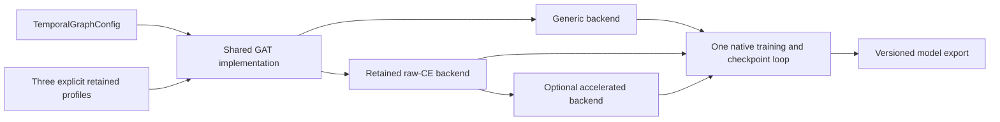
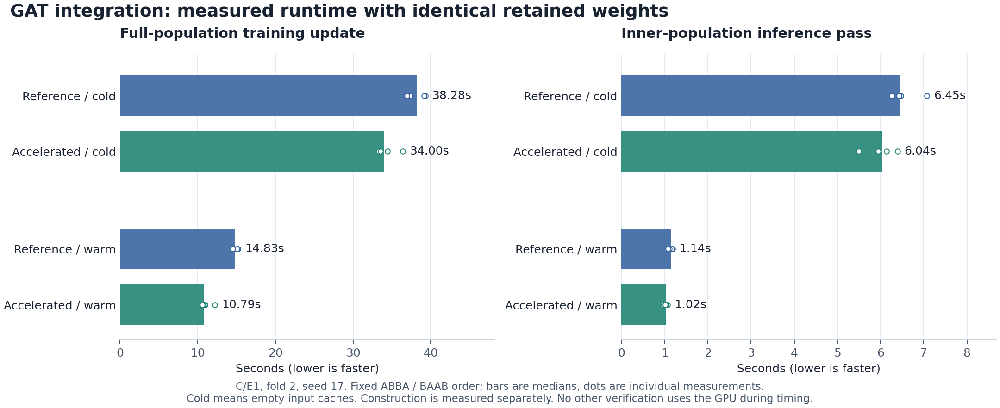

# GAT integration: review candidate

The retained GAT architectures and optional acceleration are integrated on `codex/gat-main-integration`, based on main `64861849d8b7044e0b209b9ac9db28080a92b1e4`. The reference and acceleration commits were pushed for review; nothing has been merged. The original research checkout and its uncommitted work remain unchanged.

The reference foundation is commit `e8210cb8237e71c3b1b3ad2f5169d1f62d83cb0d`; acceleration is commit `06d6ad6d0e7bd6fba6cbc5d3b2862afe25f0c3e1`. The original integration gates, 822-case record, full replay and timings below refer to that source. An independent audit subsequently found a missing historical statistic-release boundary; the focused correction and its separate verification are recorded next. The authority is `GAT_RECONCILIATION_DECISIONS.md`, which supersedes `GAT_MERGE_PLAN.md`, plus the corrected handoff index dated 2026-11-04.

## Independent audit correction: historical statistic releases

The audit's P2 finding was reproduced locally before changing production code. With `temporal_mode='historical'`, `statistic_availability_policy='per_stat_release_v1'`, and a selected statistic's release column, input preparation raised `AttributeError` because a synthetic snapshot lacked `cutoff`. Four pre-existing control configurations passed.

Historical batches can contain the same source row at several query times. `TimeIndexedPlan` now encodes contiguous query-time blocks using each query's configured local-midnight history cutoff. It preserves row order and duplicates and delegates masking to the existing scalar encoder. An empty batch receives a valid cutoff but carries no observations. The original source-row cache path remains in use when encoding is independent of releases. Only `graphs/temporal.py` changed in production code.

| Follow-up check | Result |
| --- | --- |
| New historical-release regressions | 22 passed, including CPU/CUDA coverage |
| Temporal attention, reconciliation, preparation/cache and integration-gate suites | 140 passed |
| Four pre-existing control configurations | Exact before/after inputs, initial parameters and encoder outputs |
| Original worktrees, research artifacts and prior integration receipts | 6,023 distinct files hashed; no mismatches |

The new cases cover release just before, exactly at, and just after the cutoff; missing release timestamps; repeated source rows at different historical times; later queries followed by earlier queries; empty history; and agreement with direct recursive snapshots across one to three layers and both time encodings. The recursive test oracle now supplies its own snapshot cutoff explicitly.

All **162 focused cases passed**, with no failures or skips in the completed runs. The first broad invocation encountered two pytest temporary-directory setup errors after 46 passes; the unchanged suite passed all 140 cases using a fresh short native Windows temporary directory. Both attempts and the original failing regression are retained. [Follow-up verification](data/gat_historical_release_fix_20261104/verification.json) records source hashes, exact control comparisons and receipt hashes; full local evidence is under `experiments/gat_historical_release_fix_20261104_01`.

No real-data fit, retained-profile replay, benchmark, dependency change, or research-grid expansion was performed for this correction. Retained profiles use `time_features`, so they do not enter the corrected historical path. Their original results remain anchored to `06d6ad6d`; the new focused checks supplement that evidence. Source-specific native resume continues to reject cross-source continuation.

## What is available

| Profile | Phase context | Goal loss weight | Parameters |
| --- | --- | ---: | ---: |
| B/N | None | 0; goal head remains materialized | 38,041 |
| C/E1 | Corrected v2 E1, explicit source ID | 0.1 | 39,065 |
| B/CD_DW | Corrected v2, explicit source ID and W10 or W20 | 0; goal head remains materialized | 38,437 |

All three retain d32, two layers, two attention heads, the original ordered shots/corners features, and the original H/D/A head. Factory settings are explicit; a factory does not select a fitted checkpoint or winning seed. Six [archived replay recipes](../../examples/gat_retained/README.md) expose the two folds and require seed 17, 42, or 73. CD_DW explicitly uses W10 in fold1 and W20 in fold2.

Generic constructors retain main's legacy gaps and statistic-availability semantics. Retained profiles explicitly select bounded gaps, rational time features and per-statistic release masking. The loader binds known original exports to a hash-backed 18-entry compatibility manifest; missing or ambiguous metadata cannot silently acquire research semantics. Old phase-v1 tables load with their original policy and source identity. New phase production uses main's current standings/countdown implementation.

Public JSON/Python recipes support the new profile, training and execution specifications. Named-data, dated-alias, membership, cutoff, current standings, venue, reporting and prediction-boundary behavior remain covered. New source-stage mappings require an explicit complete `round_stage_column`. Model loading leaves acceleration disabled. To opt in for an eligible retained model, supply `research_execution=RetainedGATExecution()` alongside `RetainedGATTraining` and its declared raw-validation-CE control; omitting the execution specification selects reference execution.

## Evidence and compatibility scope

| Gate | Result | Scope |
| --- | --- | --- |
| Pinned-main behavior | Exact on CPU and CUDA | Six cases, three complete updates each: default, released statistics under legacy semantics, memory, statistics, combined extensions, CNN. Inputs, initialization, gradients, AdamW, outputs and identities compared. |
| Retained original inference | 18/18 exact, including round trips | All original outer fixtures: 4,288 in fold1 and 4,185 in fold2, for each family and seed. Independent frozen-source forward comparison; inputs, logits, probabilities, goal rates and identities. |
| Older model exports | 54/54 exact probes and round trips | 53 representative schemas plus recovered expanded-totals fold02; four fixed original fixtures per export. This is bounded inference evidence. |
| Original profile/preprocessing contracts | Six family/fold variants | All 18 canonical initial states, ordered features, dimensions and original configuration projections; added semantic policy asserted separately. |
| Public integration | Passed | Six sealed replay recipes prepare. Fourteen public cases cover JSON/Python, fit, reuse, save/load, data-only recovery, phase-v2 production and rejection boundaries. |
| Retained training | Three families exact | Fold2, seed17, three full fitting-population updates, complete inner validation, gradients including None, AdamW, RNG, selection and restoration. |
| Native continuation | Passed in fresh processes | Three reference profiles and three accelerated profiles on CPU and CUDA, plus the generic fixture-feature route. Disposable intermediate checkpoints match uninterrupted controls; completed reopen performs zero updates. These use declared miniature populations. |
| Accelerated execution | 19/19 short checks and full replay passed | Five independent flags and combined flags for each family, plus a 1 MiB cache-budget case. |
| Representative stopping replay | All 103 updates exact | C/E1, fold2, seed17. Selected update **88**, completed update **103**, best inner raw CE **1.0002489273849902**. Selected weights and fitting/inner inference also exact. |
| Focused regression suite | **822 unique cases passed** | Latest result per case, including the CUDA follow-up; no unresolved test failures or skips. |
| Inventory generation | Deterministic | Two identical regenerations; seven graph additions, no removed components, and unchanged non-graph components/stages/metrics versus independently regenerated main. |
| Original-source preservation | Passed | 5,613 distinct files hashed, original five worktree registrations/statuses unchanged, all supplied source/artifact inventory entries match. |

The full replay took 19.60 minutes, including its verification/checkpoint overhead. This is an engineering acceptance replay. No research grid, architecture search, beta selection, residual sweep, or new outer performance evaluation was performed. The speed checks produce fitting/inner outputs only. Retained outer forward execution is confined to the explicit original-model parity gate.

The original retained backend oracle uses the archived class and exact numerical helper definitions, with file hashes and selected definitions recorded. Explicit original path bindings avoid an unused reporting import absent from that frozen closure. It does not substitute the integrated implementation for the independent numerical oracle.

## Runtime and memory

| Measurement | Reference median | Accelerated median | Reference / accelerated |
| --- | ---: | ---: | ---: |
| Training update / cold cache | 38.276 s | 33.997 s | 1.13x |
| Training update / warm cache | 14.831 s | 10.794 s | 1.37x |
| Inner inference / cold cache | 6.449 s | 6.041 s | 1.07x |
| Inner inference / warm cache | 1.139 s | 1.021 s | 1.11x |

Fixed ABBA/BAAB order, four constructed backends per arm, three complete updates per trial: four cold-cache and eight warm-update measurements per arm. Inner inference is measured separately after restoring identical selected weights, with four cold-cache and four warm-cache passes. Outputs are copied to CPU and checked. Construction is excluded from those timings and reported below. Cold refers to input caches within one process, not a fresh Python process. These are C/E1 fold2 measurements on this machine, not general throughput guarantees or public end-to-end prediction latency.

| Arm | Construction median | CUDA allocated peak, GiB | CUDA reserved peak, GiB | Sampled process RSS peak, GiB |
| --- | ---: | ---: | ---: | ---: |
| Accelerated | 12.29 s | 1.489 | 1.508 | 1.825 |
| Reference | 12.55 s | 1.518 | 1.549 | 1.839 |

Memory columns are medians of four per-trial peaks. CUDA peaks include construction and three training updates. RSS is sampled every 20 ms after construction; it can miss short spikes and is distinct from private memory. No other verification job used the GPU during timing. Parallel short-check runtimes are excluded from speed conclusions.

Acceleration preserves parameter registration, initialization, loss reduction and selection. Its borrowed cache owns one train/validation device-input budget; native duplicate residency is disabled, indices/transient transfers are counted, public access keeps copying, and completion/error releases ownership. Full-run cache statistics are recorded before the final cleanup; ownership tests verify cleanup behavior. The low-budget run retains no inputs at completion; its largest required transient was 4,948,724 bytes, explicitly accounted for despite the 1 MiB residency budget.

Skipping diagnostic replay publishes `pre_update_train_ce`, `pre_update_train_goal_loss`, `pre_update_train_regularization` and `pre_update_train_objective`. It removes the post-update replay and its replay-only failure check. Raw validation CE still selects checkpoints. The runtime benefit therefore includes the explicitly authorized reduction in diagnostic work; it is not solely faster arithmetic.

## Saved report arithmetic

| Retained family | Raw CE | RPS | Argmax accuracy |
| --- | ---: | ---: | ---: |
| time_B/CD_DW | 1.007471848261 | 0.204497066447 | 49.974429% |
| time_B/N | 1.007665945797 | 0.204524841155 | 50.005901% |
| time_C/E1 | 1.007575891381 | 0.204473362908 | 50.076714% |

These reproduce the supplied saved-output audit to at most 2.7e-15 in CE and 2.3e-16 in RPS. Each seed is scored separately over its 8,473 pooled outer fixtures, then the three scores are averaged. Probabilities use H/D/A order and float64 normalization. No probability ensemble is evaluated. RPS is half the sum of the two cumulative squared errors. This arithmetic check supports report fidelity; independent forward comparisons establish inference parity.

Original reports and calibration metadata remain untouched. The speed/residual study used raw probabilities; the corners study also retains calibration outputs. The actual residual selection remains fold1 C/E1 NONE and fold2 B/N EDGE. Keeping the later R_NONE families is a separate simplicity decision.

## Recovered evidence and limits

Both Space ZIPs were downloaded and SHA256-verified against the corrected index. The expanded-fold archive's eight model/data files match the original isolated-copy receipt. Its 213-file runtime source closure was recovered from Git `11ffa446`, with recorded line-ending normalization. The older four-study ZIP has one reporting member inconsistent with its source manifest; a separate runtime copy uses the untouched research file that matches the manifest exactly. Seven missing rest/propagation source members were recovered from `9499d4af` with exact hashes. Original archives and manifests were preserved.

The 54 older-export checks cover the stated probes; they do not certify every historical population or optimizer continuation. Other unavailable historical model families remain unverified. October25 temporal and October26 goal-auxiliary fits lack the relevant native intermediate states. Retained selected exports can pair restored weights with terminal optimizer state, and their old terminal checkpoints are stopped. Neither establishes clean continuation from the selected update. Cross-source native resume continues to reject; extending a phase table requires a new identity and is outside this integration.

Earlier failed checks remain in the evidence folder. Corrected implementation issues include legacy identity projection, JSON-stable competition identities, data-only public phase recovery, and default cache-policy normalization. Source-sensitive resume was rerun after code stopped changing. Windows long-path dataset publication failures passed in a fresh shorter temporary directory without changing application behavior. Initial collection errors are resolved by subsequently collected passing cases.

The first full speed attempt matched update1, then failed because its verification harness omitted the caller-owned directory required by the native checkpoint writer. The corrected harness creates a fresh unique directory. All model/training source hashes and every worker AST node outside `full()` were unchanged; 19 verified short receipts were carried into `speed_acceptance_v2` with explicit provenance. The failed queue and its source are retained. No numerical failure was waived. The final GPU test invocation initially skipped 15 cases requiring a second idle-GPU opt-in flag; the report gate rejected those skips, and all 15 subsequently passed with both flags.

## Review and rollback

The original research branch remains at `9499d4afd85933304a47034d05baad0913c43cab`, with 20 modified tracked and 40 untracked status entries, and no staged changes. The other original worktrees, including pre-existing damaged temporary checkouts, were preserved. Twenty-one designated main files remain byte-equivalent after line-ending normalization. The complete `src` snapshot and numerical queue seal record `06d6ad6d`; the historical-release correction has its own source hashes and verifies that it changes only the declared production file.

The candidate is ready for review within these verified scopes. Generic execution is the default; disabling the execution spec returns retained training to reference execution. The reference, acceleration and historical-release correction can be reviewed separately. New-schema exports require the integrated loader. Original exports, original frozen runtimes and all prior artifacts remain the rollback authority. A merge remains pending user review.

[Compact acceptance data](data/gat_research_merge_20261104/acceptance.json) contains gate summaries and receipt hashes. [Timing data](data/gat_research_merge_20261104/speed_measurements.json) accompanies the plot. The complete local [artifact index](../../experiments/gat_integration_20261104_01/ARTIFACT_INDEX.json) links the preserved attempts, raw receipts and source seals; the full evidence folder is intentionally outside Git.
